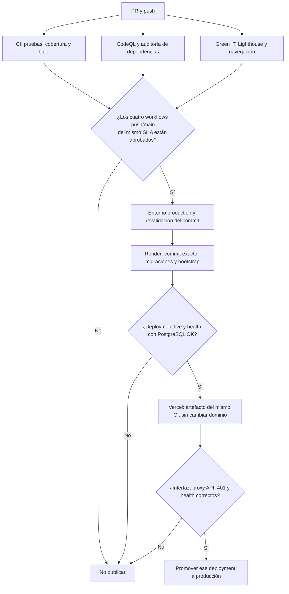

# CI/CD de EcoLogística Lima

**Versión:** 1.0.2 · **Fecha:** 10/11/2026 · [Volver al README](../README.md)

## Distribución acordada

| Componente | Alojamiento | Acceso |
|---|---|---|
| React / TypeScript / Vite | Vercel | HTTPS público |
| FastAPI / SQLAlchemy | Render Web Service, Docker | HTTPS público; endpoints protegidos con Bearer/RBAC |
| PostgreSQL 16 | Render Postgres | Conexión interna del backend, en la misma región |

La base se crea una vez y conserva sus datos entre publicaciones. El navegador solo
accede a la API. El frontend utiliza rutas relativas `/api/v1`; Vercel las reenvía a
Render conservando ruta, parámetros y métodos. No necesita credenciales de PostgreSQL,
un cambio de stack ni una segunda implementación de autenticación.

## Estado de la configuración

La aplicación está disponible en [ecologistica-lima.vercel.app](https://ecologistica-lima.vercel.app)
y la API en [Render /docs](https://ecologistica-lima-api-ktea.onrender.com/docs).
Se verificaron externamente la página de acceso y `/health`, incluida la conexión real
con PostgreSQL. El pipeline y sus pruebas se encuentran en GitHub; consultar la
[última ejecución de Actions](https://github.com/jmartinez278/Ecolog-stica_Lima/actions)
para conocer el resultado de cada entrega automática, sin atribuirle una revisión humana.

- Vercel: proyecto `ecologistica-lima`, equipo `ynsm8s-projects`.
- Render: workspace confirmado `ynsm8's projects`, API `srv-dbpo44mc6qcc73e3nsf0`,
  PostgreSQL `dpg-dbpo3p6c6qcc73e3mh20-a`, región Oregon.
- La base gratuita caduca el **10/12/2026**. La nube tiene una base nueva con el cliente
  inicial; los registros locales no se importan automáticamente.
- `CD_ENABLED=true`; variables públicas y secretos configurados a nivel repositorio.
- El usuario inicial es `operador@example.test`; consultar su contraseña generada
  únicamente en Render → Environment → `BOOTSTRAP_OPERATOR_PASSWORD`.
- El MCP Render devolvió `Unknown tool`; el aprovisionamiento se hizo con la CLI oficial
  autenticada. GitHub `YnsM8` tiene escritura, pero no administración; las protecciones
  adicionales del entorno corresponden al propietario del repositorio.

## 1. Preparar GitHub

1. Publicar la rama de trabajo, abrir un PR y revisar los cambios antes de integrarlos
   en `main`. Los pipelines de pull request no tienen acceso a credenciales de producción.
2. En **Settings → Branches / Rulesets**, proteger `main`: exigir PR, revisión y los
   controles de calidad, PostgreSQL, seguridad y Green IT. El CD también comprueba
   las conclusiones de los cuatro workflows por SHA.
3. En **Settings → Environments**, crear `production`. Restringirlo a `main` y configurar
   un revisor requerido cuando el plan de GitHub lo permita. La aprobación del entorno
   corresponde al commit concreto que se liberará.
4. En **Settings → Actions → General**, permitir las acciones utilizadas en los
   workflows y la lectura de artefactos del mismo repositorio.

## 2. Crear PostgreSQL en Render

El archivo [render.yaml](../render.yaml) prepara conjuntamente API y PostgreSQL 16,
ambos con plan gratuito y región Oregon. Mantiene Auto-Deploy Off, obtiene la conexión
por referencia y genera JWT/contraseña inicial en Render. Validar y revisar el plan
antes de aplicarlo; no adoptar recursos existentes sin confirmar sus nombres.
El usuario puede consultar la contraseña generada en Environment del backend y cambiar
el correo inicial antes del primer arranque. El bootstrap no modifica usuarios existentes.

La creación manual equivalente es:


1. Abrir Render y elegir **New → Postgres**.
2. Elegir PostgreSQL **16** y la región en la que se creará el backend.
3. Elegir conscientemente el plan: la base gratuita de Render caduca **30 días** después
   de crearla; no sirve como almacenamiento permanente de una entrega prolongada.
4. Guardar la **Internal Database URL** en la configuración del backend. No publicarla
   en GitHub, documentos, capturas ni el frontend.
5. Una base nueva está vacía. Si se requieren los registros locales, hacer un respaldo
   e importar los datos a la base nueva en un paso controlado; el pipeline no copia
   automáticamente la información de Docker local.

No habilitar la carga de auditoría `seed_carga.py` en esta base. Para bases ya utilizadas,
hacer un respaldo antes de migrar. Una colisión de emails detiene Alembic para que el
responsable resuelva los duplicados sin borrar registros automáticamente.

## 3. Crear el backend en Render

Crear **New → Web Service**, conectando este repositorio:

| Opción | Valor |
|---|---|
| Repositorio | `jmartinez278/Ecolog-stica_Lima` |
| Branch | `main` |
| Runtime / Language | Docker |
| Root Directory | `src/backend` |
| Dockerfile Path | `./Dockerfile` (relativo al directorio raíz seleccionado) |
| Docker Command | `sh /app/start_render.sh` |
| Health Check Path | `/health` |
| Auto-Deploy | **Off** |
| Región | La misma que PostgreSQL |
| Instancias | Una en esta configuración inicial |

`start_render.sh` aplica `alembic upgrade head`, ejecuta el bootstrap idempotente de
roles, operador y cliente inicial, y arranca Uvicorn en `0.0.0.0:$PORT`. Si falla una
migración, no arranca la API. No cambia la contraseña de un operador que ya existe.
La orden Docker por defecto del desarrollo local permanece disponible.

En **Environment** de Render configurar:

| Variable | Contenido |
|---|---|
| `DATABASE_URL` | URL **interna** de PostgreSQL; el arranque acepta `postgresql://`, `postgres://` y `postgresql+psycopg://`, y selecciona psycopg 3 sin imprimir la URL |
| `JWT_SECRET` | Clave aleatoria propia del despliegue |
| `BOOTSTRAP_OPERATOR_EMAIL` | Correo real elegido para el operador inicial |
| `BOOTSTRAP_OPERATOR_PASSWORD` | Contraseña propia, que no contenga el marcador `replace` |

Render proporciona `PORT`; no fijarlo a `localhost` ni copiar el host `db` de Compose.
Anotar el ID del servicio (`srv-…`) y su URL HTTPS asignada por Render (`https://….onrender.com`).
El CD comprueba que esa URL pertenece al servicio, que usa este repositorio y `main`,
y que Auto-Deploy está desactivado antes de solicitar el commit exacto.

Crear una API key de Render con acceso al servicio de destino. Se guardará únicamente
como secreto del repositorio en GitHub Actions.

## 4. Preparar Vercel

1. Crear o seleccionar el proyecto del frontend en la cuenta/equipo correcto.
2. Si se importa el monorepo, elegir `src/frontend` como Root Directory y Vite como
   framework. El build habitual es `npm run build`, con salida `dist`.
3. El archivo `src/frontend/vercel.json` desactiva los despliegues automáticos por Git.
   Comprobarlo también en la integración del proyecto: GitHub Actions debe controlar
   las publicaciones para que una integración paralela no omita el CI.
4. Anotar **Project ID** y **Team ID / Org ID** desde la configuración del proyecto.
   Crear un token de Vercel para el equipo elegido y guardarlo en GitHub.
5. Mantener Deployment Protection. El smoke utiliza `vercel curl` con el mismo
   `VERCEL_TOKEN`: la CLI gestiona el acceso al deployment protegido. No se necesita
   crear ni compartir un tercer secreto de bypass para el pipeline.

El CD usa la CLI Vercel **65.14.0**, fijada en el workflow. Recupera el `dist` compilado
por CI y lo empaqueta en Build Output API v3. No reconstruye el frontend con otro
commit ni descarga variables del backend. En esta aplicación estática no se requiere
`vercel pull`: el paquete contiene rutas/estáticos completos y un `project.json` con
los IDs del destino, sin funciones ni variables de build propias de Vercel. El
empaquetador conserva la ruta `src/frontend` que valida la CLI para el Root Directory
del monorepo y procesa explícitamente la salida JSON de `vercel deploy --json`.

## 5. Configurar variables y secretos de GitHub

En **Settings → Secrets and variables → Actions**, introducir estos valores directamente
en la interfaz de GitHub. Esta configuración utiliza variables y secretos del repositorio;
un administrador puede trasladarlos a `production` si habilita restricciones adicionales. No pegar tokens ni contraseñas en el chat.

**Repository variables** (no son contraseñas):

| Nombre | Valor |
|---|---|
| `BACKEND_URL` | URL HTTPS asignada al servicio Render, sin ruta ni query |
| `FRONTEND_URL` | Dominio público de producción: `https://ecologistica-lima.vercel.app` |
| `RENDER_SERVICE_ID` | ID `srv-…` del backend |
| `VERCEL_ORG_ID` | ID del equipo/cuenta de Vercel |
| `VERCEL_PROJECT_ID` | ID del proyecto frontend |

**Repository secrets**:

| Nombre | Contenido |
|---|---|
| `RENDER_API_KEY` | Token Render autorizado para desplegar el backend |
| `VERCEL_TOKEN` | Token del equipo/cuenta Vercel |

`DATABASE_URL`, `JWT_SECRET` y las credenciales del operador permanecen en Render.
No son necesarios en GitHub ni en Vercel para este pipeline.

Finalmente, en **Settings → Secrets and variables → Actions → Variables** del
**repositorio** (no del entorno), crear `CD_ENABLED` con valor `true`.
Si falta o es distinto, el workflow CD queda omitido y el CI sigue funcionando.

## 6. Funcionamiento del pipeline



- `cd.yml` se evalúa al terminar cualquiera de los cuatro controles. Si aún falta
  alguno, omite la liberación; al terminar el último, vuelve a comprobar todos.
- Solo admite el repositorio oficial, eventos `push` de `main` y el SHA actual de esa
  rama. Rechaza PR, forks, commits antiguos, pruebas faltantes y controles fallidos,
  cancelados u omitidos. Una nueva ejecución fallida prevalece sobre una antigua exitosa.
- Recupera el artefacto `frontend-dist-SHA` del run CI aprobado, con retención de siete días.
- Serializa liberaciones sin cancelar una migración iniciada. Un deployment `production`
  exitoso del mismo SHA evita publicaciones duplicadas por los cuatro eventos.
- Revalida los controles después de esperar la aprobación del entorno.
- El backend debe confirmar `live` y el mismo SHA. El endpoint `/health` consulta
  PostgreSQL realmente, no solo el proceso HTTP.
- Vercel recibe un deployment **de producción** con `--skip-domain`. El smoke comprueba
  HTML prerenderizado, `/health` y JSON `401` de una consulta sin sesión a través del
  proxy mediante `vercel curl`; después se promueve exactamente ese deployment mediante
  la API de proyectos de Vercel, con `teamId` explícito y sin consultas a la identidad
  personal del token. Se confirma que el dominio público resuelve al mismo deployment.
- Tokens del repositorio solo en los pasos de release que los necesitan. No se suben `.env`, `.vercel`, tokens,
  estado de sesión ni trazas autenticadas como artefactos.

Los recorridos autenticados con escrituras y las pruebas de persistencia se ejecutan
antes, en CI y PostgreSQL aislado. El smoke externo no inserta ni cancela datos reales.
La prueba manual de acceso y funcionalidades en el dominio final sigue siendo parte
de la revisión de la liberación.

## 7. Cómo comprobar o repetir una liberación

1. En **Actions**, abrir las cuatro ejecuciones del SHA de `main` y comprobar que
   terminaron correctamente. Si una falló, corregir la causa; no omitir ese control.
2. Abrir **ECO - CD Vercel y Render**. Revisar `gate`, la aprobación de `production`,
   el ID de despliegue Render, el smoke y la promoción de Vercel.
3. Para reintentar un fallo de infraestructura, usar **Run workflow → main**. Se vuelven
   a exigir los cuatro controles del commit actual; no permite desplegar un SHA antiguo.
   Si el artefacto caducó, reejecutar CI para regenerarlo antes de reintentar CD.
4. Para detener futuras publicaciones, poner `CD_ENABLED=false`. No cancela una
   migración ni apaga el deployment existente.

No es una transacción atómica entre proveedores: si Vercel falla después de publicar
Render, el backend puede estar actualizado y el frontend activo seguirá en su versión
anterior. Mantener API y migraciones compatibles con esa versión. Para revertir código,
preferir un PR de reversión y volver a pasar el pipeline; no ejecutar automáticamente
`alembic downgrade` ni restaurar una base sobre datos actuales. Los respaldos y la
recuperación de datos deben verificarse por separado.

## Validación local del pipeline

```bash
python3 -m unittest discover -s scripts -p 'test_cd.py' -v
python3 scripts/check_markdown_links.py
sh -n src/backend/start_render.sh
docker build -t ecologistica-backend-check:local src/backend
```

Estas comprobaciones y las pruebas locales no acreditan un despliegue real en Render
ni Vercel. Los resultados de la primera ejecución externa se revisarán al configurar
los destinos y activar el CD.

## Referencias oficiales

- [GitHub Actions: eventos workflow_run](https://docs.github.com/en/actions/reference/workflows-and-actions/events-that-trigger-workflows#workflow_run).
- [Vercel: deploy prebuilt y producción](https://vercel.com/docs/cli/deploy).
- [Vercel Build Output API](https://vercel.com/docs/build-output-api/configuration).
- [Vercel: desactivar deployments automáticos por Git](https://vercel.com/docs/project-configuration/git-configuration).
- [Render: despliegues y Auto-Deploy Off](https://render.com/docs/deploys).
- [Render: solicitar un commit concreto mediante la API](https://api-docs.render.com/reference/create-deploy).
- [Render Postgres: conexión interna y región](https://render.com/docs/postgresql-creating-connecting).
- [Render: límites de los servicios gratuitos](https://render.com/docs/free).
