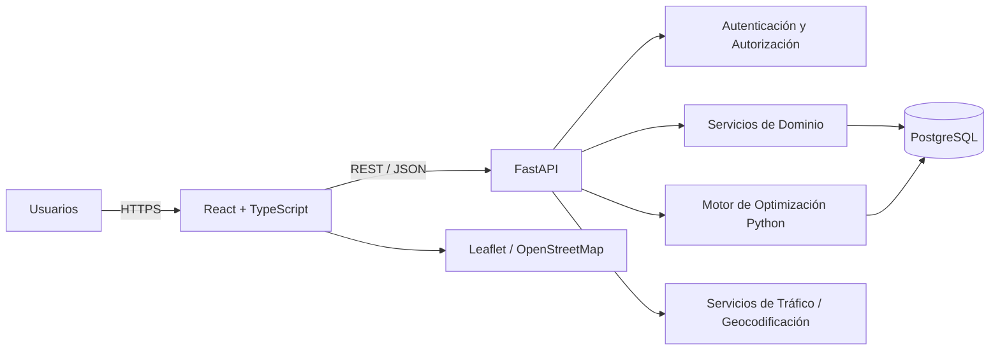

# EcoLogística Lima

**Versión de este README:** 1.2.7 · **Actualizado:** 25/10/2026

**EcoLogística Lima** es un proyecto de software orientado a la optimización sostenible de rutas de distribución de última milla para el escenario empresarial de **DistriRápido S.A.C.**

La solución busca mejorar la planificación logística mediante la gestión de pedidos, vehículos y conductores. La generación de rutas optimizadas, re-optimización ante incidencias, visualización cartográfica e indicadores económicos y ambientales pertenecen a etapas posteriores del MVP.

---

## Objetivo

Diseñar y desarrollar un MVP capaz de optimizar rutas de distribución considerando simultáneamente:

- Distancia recorrida.
- Tiempo de entrega.
- Capacidad de los vehículos.
- Ventanas de tiempo.
- Disponibilidad de conductores.
- Consumo de combustible.
- Emisiones de CO₂.
- Prioridad de pedidos.
- Restricciones de seguridad e infraestructura vial.
- Cambios operativos durante la ejecución.

---

## Alcance del MVP

El sistema contempla los siguientes módulos:

1. Gestión de flota.
2. Gestión de pedidos.
3. Generación de rutas optimizadas.
4. Visualización de rutas en mapa.
5. Dashboard de indicadores.
6. Reportes de sostenibilidad.
7. Re-optimización dinámica.
8. Gestión de conductores.
9. Gestión de clientes.
10. Seguimiento de emisiones.

---

## Stack Tecnológico

| Capa | Tecnología |
|---|---|
| Frontend | React + TypeScript |
| Backend | Python + FastAPI |
| Base de datos | PostgreSQL |
| Optimización futura | Python |
| Mapas futuros | Leaflet + OpenStreetMap |
| API | REST / JSON |
| Documentación API | OpenAPI |
| Pruebas Backend | Pytest |
| Pruebas Frontend | Vitest / React Testing Library |
| Contenedores | Docker |
| CI/CD previsto | GitHub Actions |

---

## Arquitectura General



El diagrama representa la arquitectura objetivo del MVP; el Sprint 1 implementa interfaz, API, autenticación, servicios y persistencia. El optimizador, las integraciones externas y el mapa quedan pendientes. La arquitectura utiliza separación entre:

- Interfaz de usuario.
- API.
- Servicios de dominio.
- Motor de optimización.
- Persistencia.
- Integraciones externas.

---

## Requisitos Clave

### Rendimiento

- Generación de rutas: **≤ 45 segundos** para hasta 150 pedidos y 15 vehículos.
- Re-optimización: **< 30 segundos**.

### Escalabilidad

La arquitectura debe contemplar crecimiento hasta:

- **1,000 pedidos diarios**.
- **50 vehículos**.

### Disponibilidad

- Objetivo: **99.5%** durante el horario operativo de 5:00 AM a 10:00 PM.

### Seguridad

- Autenticación.
- Autorización RBAC/ABAC.
- HTTPS/TLS.
- Protección frente a OWASP Top 10.
- Auditoría de operaciones críticas.

### Accesibilidad

- WCAG 2.1 nivel AA.

---

## Usuarios Principales

| Rol | Responsabilidad |
|---|---|
| Administrador | Usuarios, roles y configuración |
| Operador Logístico | Pedidos, flota y generación de rutas |
| Supervisor | Supervisión de rutas e indicadores |
| Conductor | Consulta de rutas y paradas asignadas |
| Gerencia | KPIs, costos y sostenibilidad |
| Auditor | Consulta de trazabilidad |

---

## Estructura del repositorio

```text
EcoLog-stica-Lima/
├── README.md
├── .gitignore
├── .env.example
├── docker-compose.yml
├── src/
│   ├── backend/
│   └── frontend/
└── docs/
    ├── 01 Inicio/
    ├── 02 Planificación/
    └── 03 Implementación/
```

---

## Fase 02: Planificación del Proyecto

Los cuatro entregables obligatorios de la consigna de planificación se encuentran en `docs/02 Planificación/`. Cada documento incluye un enlace de retorno a este README.

| Entregable | Documento |
|---|---|
| 1. Transformación ágil, historias, BDD y DoD | [01 Transformando a ágil V_1_0_1](<docs/02 Planificación/01 Transformando a ágil V_1_0_1.md>) |
| 2. Configuración y evidencias de Jira | [02 Artefactos Jira V_1_0_2](<docs/02 Planificación/02 Artefactos Jira V_1_0_2.md>) |
| 3. Matriz de riesgos y respuestas | [03 Registro de riesgos V_1_0_0](<docs/02 Planificación/03 Registro de riesgos V_1_0_0.md>) |
| 4. Presupuesto financiero del MVP | [04 Presupuesto del proyecto V_1_0_0](<docs/02 Planificación/04 Presupuesto del proyecto V_1_0_0.md>) |

**Estado y alcance temporal:** son artefactos documentales de planificación. El presupuesto es una **estimación de planificación** pendiente de validación del equipo, no evidencia de gastos. El documento adicional [Seguimiento Jira Sprint 2](<docs/02 Planificación/Anexos/Seguimiento Jira Sprint 2 V_1_0_3.md>) es un anexo de seguimiento posterior y no sustituye al cuarto entregable obligatorio.

## Documentación del Proyecto

| Documento | Contenido |
|---|---|
| 01 | Selección y justificación del enfoque híbrido |
| 02 | Acta de constitución |
| 03 | Visión del producto |
| 04 | Supuestos y restricciones |
| 05 | Registro de interesados |
| 06 | Requisitos funcionales |
| 07 | Requisitos no funcionales |
| 08 | Usuarios, roles y permisos |
| 09 | Reglas de negocio y trazabilidad |
| 10 | Evaluación y selección del stack |
| 11 | Diseño de base de datos |
| 12 | Arquitectura C4 |
| 13 | Análisis multidimensional de restricciones |

### Entregables del Sprint 1

| Documento | Enlace relativo |
|---|---|
| Informe de estado del proyecto | [01 Informe de estado del proyecto V_1_0_0](<docs/03 Implementación/Sprint 1/01 Informe de estado del proyecto V_1_0_0.md>) |
| Registro de impedimentos | [02 Registro de Impedimentos V_1_0_0](<docs/03 Implementación/Sprint 1/02 Registro de Impedimentos V_1_0_0.md>) |
| Revisión del Sprint | [03 Revisión del Sprint V_1_0_0](<docs/03 Implementación/Sprint 1/03 Revisión del Sprint V_1_0_0.md>) |
| Retrospectiva del Sprint | [04 Retrospectiva del Sprint V_1_0_0](<docs/03 Implementación/Sprint 1/04 Retrospectiva del Sprint V_1_0_0.md>) |

La revisión documenta el estado **antes** de la presentación del 29/09/2026. La retrospectiva contiene un análisis y plan de acción; sus responsables y acuerdos requieren confirmación del equipo.

### Entregables del Sprint 2

| Documento | Enlace relativo |
|---|---|
| Informe de estado del proyecto | [01 Informe de estado del proyecto V_1_0_0](<docs/03 Implementación/Sprint 2/01 Informe de estado del proyecto V_1_0_0.md>) |
| Registro de impedimentos | [02 Registro de Impedimentos V_1_0_0](<docs/03 Implementación/Sprint 2/02 Registro de Impedimentos V_1_0_0.md>) |
| Revisión del Sprint | [03 Revisión del Sprint V_1_0_0](<docs/03 Implementación/Sprint 2/03 Revisión del Sprint V_1_0_0.md>) |
| Retrospectiva del Sprint | [04 Retrospectiva del Sprint V_1_0_0](<docs/03 Implementación/Sprint 2/04 Retrospectiva del Sprint V_1_0_0.md>) |
| Informe de implementación | [05 Informe de implementación del Sprint 2 V_1_0_0](<docs/03 Implementación/Sprint 2/05 Informe de implementación del Sprint 2 V_1_0_0.md>) |

El [seguimiento Jira del Sprint 2](<docs/02 Planificación/Anexos/Seguimiento Jira Sprint 2 V_1_0_3.md>) recoge las cinco historias, Story Points y estado del tablero consultado el 06/10/2026. La documentación distingue funcionalidades implementadas de historias formalmente aceptadas; la demostración y retrospectiva del equipo siguen sin evidencia de realización.

Jira programó el Sprint 2 del **22/09/2026 a las 19:59:45** al **06/10/2026 a las 19:59:35**, hora de Lima. El commit y el PR de implementación tienen fecha del 06/10; no se atribuye desarrollo a días anteriores sin evidencia. **Una historia solo se cierra cuando cumple todos los puntos aplicables del Definition of Done**; los escenarios BDD están incluidos en DoD-10. Los pendientes sin fecha propia en Jira requieren replanificación si exceden el fin programado.

Para ejecutar el proyecto, consultar las instrucciones técnicas del [backend](src/backend/README.md) y el [frontend](src/frontend/README.md). Los criterios oficiales de aceptación y el Definition of Done están en [Transformando a ágil](<docs/02 Planificación/01 Transformando a ágil V_1_0_1.md>). Las capturas de planificación, identificadas según su contenido real, están en [Artefactos Jira](<docs/02 Planificación/02 Artefactos Jira V_1_0_2.md>).

La verificación técnica del 29/09/2026 pasó con Docker Compose, PostgreSQL aislado, API y frontend: 9 pruebas backend (91,35 % de cobertura), 4 pruebas frontend, build y un recorrido HTTP de US-001 a US-010. La interfaz cargó y navegó sin desbordamiento horizontal a 360 px en el navegador probado. A las 15:04 (hora de Lima) se repitieron el arranque, las pruebas y el build en otro proyecto Compose aislado. La demostración ante interesados y la reunión de retrospectiva del equipo siguen sin evidencia de realización.

Para Sprint 2, la revisión del 06/10/2026 ejecutó 14 pruebas backend con 92,41 % de cobertura total sobre SQLite y PostgreSQL aislado, 5 pruebas frontend, build y arranque de Compose. Los módulos backend afectados por conductores y clientes obtuvieron 96–100 % de cobertura. API, OpenAPI, inicio de sesión, listas y proxy respondieron en `localhost`; los detalles están en el [informe técnico de implementación](<docs/03 Implementación/Sprint 2/05 Informe de implementación del Sprint 2 V_1_0_0.md>). En el corte histórico del 06/10/2026, ECO-17 a ECO-21 estaban en `In Review / QA` y sin responsable; ese estado no representa el corte actual del tablero. La [conciliación de Sprints 1 y 2](<docs/03 Implementación/Pre-Sprint 3/04 Estado de Sprints 1 y 2 V_1_0_0.md>) registra por separado la consulta del 24/10/2026 y los DoD aún pendientes de validación.

---

## Modelo de Datos Principal

La base de datos contempla, entre otras, las siguientes entidades:

- Usuarios.
- Roles.
- Vehículos.
- Conductores.
- Clientes.
- Pedidos.
- Rutas.
- Paradas.
- Incidencias.
- Registros de emisiones.
- Auditoría.

PostgreSQL se utiliza como sistema gestor principal y se contempla **PostGIS** como extensión futura en caso de requerirse consultas geoespaciales avanzadas.

---

## API

El backend de los Sprints 1 y 2 es una API REST desarrollada con FastAPI.

Grupos de recursos de la arquitectura objetivo (`auth`, `vehiculos`, `pedidos`, `conductores` y `clientes` están implementados hasta el Sprint 2):

```text
/api/v1/auth
/api/v1/usuarios
/api/v1/roles
/api/v1/vehiculos
/api/v1/conductores
/api/v1/clientes
/api/v1/pedidos
/api/v1/rutas
/api/v1/incidencias
/api/v1/dashboard
/api/v1/emisiones
/api/v1/reportes
/api/v1/auditoria
```

FastAPI permitirá generar documentación OpenAPI para facilitar la validación e integración del frontend.

---

## Motor de Optimización

El componente de optimización se mantiene separado de la capa HTTP.

El motor debe considerar variantes de:

- Vehicle Routing Problem.
- VRPTW.
- Green VRP.
- Optimización multiobjetivo.

Los principales criterios de evaluación serán:

- Distancia.
- Tiempo.
- Combustible.
- Emisiones.
- Penalizaciones.
- Cumplimiento de ventanas.
- Capacidad.
- Seguridad.

---

## Equipo

- Luis Antony Gonzalo Guerrero
- Jhon Robert Paitan Montes
- Marco Jhair Martinez Llanos
- Piero Pool Chauris Leguia
- Rodrigo Vladimir Arce Curi

La lista actual de cinco integrantes fue confirmada por el usuario mediante una imagen el 29/09/2026. Los documentos iniciales enumeran cuatro; falta confirmar desde cuándo participa Piero antes de corregir registros históricos.

---

## Seguridad y comprobaciones pre-Sprint 3

El [registro de preparación técnica de seguridad](<docs/03 Implementación/Pre-Sprint 3/02 Informe de seguridad V_1_0_0.md>) contiene los informes de CodeQL y auditoría de dependencias del 24/10/2026, los cambios de versión y las limitaciones de cada evidencia. La [validación de integridad y auditoría DoD-09](<docs/03 Implementación/Pre-Sprint 3/03 Informe de integridad y auditoría V_1_0_0.md>) documenta las pruebas automatizadas del backend ejecutadas sobre SQLite y PostgreSQL 16 aislado, con cobertura del 92,85 %. Estos resultados técnicos no sustituyen revisión humana, aceptación BDD ni staging/TLS del Definition of Done.

## Preparación técnica del cambio unificado

**Versión del proyecto:** [1.2.4 — alcance y condiciones de entrega](docs/Versiones/1.2.4.md).

La [matriz de trazabilidad BDD](docs/Calidad/01 Matriz de pruebas BDD.md) relaciona las historias US-001 a US-015 con pruebas y pendientes de aceptación. La [guía de staging](docs/Despliegue/Guía de staging.md) documenta el despliegue mediante HTTPS que debe verificar el equipo con infraestructura real; la configuración en el fork no prueba que el sitio esté desplegado. La actualización del esquema utiliza migraciones Alembic explícitas y un índice que impide correos duplicados de clientes. El [seguimiento de correcciones](docs/Calidad/02 Checklist de validación.md) distingue entregables técnicos de aprobación humana.

## Estado

### Entrega consolidada del Sprint 3

La [entrega técnica del Sprint 3](<docs/Versiones/Sprint 3 V_1_0_0.md>) se concentra en el [PR #4](https://github.com/jmartinez278/Ecolog-stica_Lima/pull/4), desde `Sprint-3` del fork hacia `main` del propietario. La [guía Sonar](<docs/Calidad/03 SonarQube local.md>) describe la ejecución local; la evidencia del commit `3c1b45d` acredita Quality Gate aprobado, cobertura global 92,4 %, nueva 100 % y cero problemas abiertos. La publicación no acredita aceptación ni cierre del sprint.

### Entregables del Sprint 3

| Criterio | Documento |
|---|---|
| Revisión del sprint | [01 Revisión del Sprint V_1_0_0](<docs/03 Implementación/Sprint 03/01 Revisión del Sprint V_1_0_0.md>) |
| Retrospectiva | [02 Retrospectiva del Sprint V_1_0_0](<docs/03 Implementación/Sprint 03/02 Retrospectiva del Sprint V_1_0_0.md>) |
| Calidad de código | [03 Calidad de código V_1_0_0](<docs/03 Implementación/Sprint 03/03 Calidad de código V_1_0_0.md>) |
| Seguridad OWASP 2025 | [04 OWASP V_1_0_0](<docs/03 Implementación/Sprint 03/04 OWASP V_1_0_0.md>) |
| Accesibilidad WCAG | [05 WCAG V_1_0_0](<docs/03 Implementación/Sprint 03/05 WCAG V_1_0_0.md>) |

La [matriz de entrega y rúbrica](<docs/03 Implementación/Sprint 03/Matriz de entrega y rúbrica V_1_0_0.md>) permite revisar los ocho criterios, sus evidencias y límites. La [adenda de planificación](<docs/02 Planificación/Anexos/Planificación Sprint 3 V_1_0_0.md>) relaciona EP-06 con RF/RNF y DoD. Los cinco informes conservan los nombres de archivo solicitados; sus versiones internas e historiales identifican las actualizaciones.

El [alcance vigente](<docs/03 Implementación/Sprint 03/Alcance de validación local V_1_0_0.md>) se limita a localhost. La [guía de staging local](<docs/Despliegue/Guía de staging.md>) describe HTTP en 8080 y TLS en 8443. La evaluación de interfaz acredita 437 comprobaciones de contraste y 16 de interacción sobre 13 estados; quedan demostración/aceptación con interesados, revisión independiente y límites de tecnología de asistencia/navegadores. No se requiere infraestructura remota.

**Checklist acumulado:** [seguimiento de correcciones en Jira y GitHub](docs/Calidad/02 Checklist de validación.md), con evidencias técnicas y pendientes que requieren decisión humana.

**Control posterior al merge, 24/10/2026:** la versión 1.2.4 se integró al `main` original mediante [PR #3](https://github.com/jmartinez278/Ecolog-stica_Lima/pull/3), commit `da3eef2`. La entrega posterior del Sprint 3 se prepara en `Sprint-3` y requiere revisión propia. La [conciliación de Sprints 1 y 2](<docs/03 Implementación/Pre-Sprint 3/04 Estado de Sprints 1 y 2 V_1_0_0.md>) conserva el corte anterior: cuatro historias de Sprint 2 finalizadas y ECO-18 en QA. No se infieren cambios de calendario ni aceptación por la integración técnica.

**Fase del incremento técnico al 06/10/2026:** incremento técnico del Sprint 2 publicado en `sprint-2` e integrado en `main`. Incorpora US-011 a US-015 sobre la base técnica del Sprint 1; la aceptación formal y el estado de Jira siguen pendientes de conciliación.

Los documentos de definición inicial se encuentran en `docs/01 Inicio/`, la planificación en `docs/02 Planificación/` y los entregables de esta iteración en `docs/03 Implementación/`.

## Historial de control de cambios del README

| Versión | Fecha | Cambio |
|---|---|---|
| 1.0.0 | 29/09/2026 | Actualización del estado del Sprint 1, distinción entre alcance implementado y objetivo del MVP, y enlaces a los cuatro entregables. |
| 1.0.1 | 29/09/2026 | Enlaces a la planificación revisada y resultado de la verificación integrada en Docker y navegador. |
| 1.0.2 | 29/09/2026 | Actualización del equipo actual a cinco integrantes y referencia al análisis retrospectivo ampliado. |
| 1.0.3 | 29/09/2026 | Ajuste de la descripción del análisis retrospectivo. |
| 1.0.4 | 29/09/2026 | Revalidación técnica del Sprint y actualización del análisis retrospectivo y la revisión. |
| 1.1.0 | 06/10/2026 | Implementación técnica de US-011 a US-015: gestión ampliada de conductores y clientes. |
| 1.2.0 | 06/10/2026 | Entregables del Sprint 2, conservación de los del Sprint 1, seguimiento del tablero Jira y distinción entre integración técnica y aceptación formal. |
| 1.2.1 | 06/10/2026 | Incorporación del informe técnico de implementación del Sprint 2. |
| 1.2.2 | 06/10/2026 | Calendario exacto de Jira, DoD como criterio único de cierre, seguimiento revisado y alcance de las verificaciones del informe técnico. |
| 1.2.3 | 06/10/2026 | Resultados locales con Docker, PostgreSQL y frontend, y estado de revisión de las cinco historias en Jira. |
| 1.2.4 | 24/10/2026 | Preparación Pre-Sprint 3: planificación completa, evidencias y arquitectura técnica, pruebas de integridad, CI, accesibilidad y modularización de interfaz. |
| 1.2.5 | 24/10/2026 | Cinco informes del Sprint 3, evidencias de calidad/seguridad/accesibilidad, adenda EP-06 y aclaración del estado posterior al merge. |
| 1.2.6 | 25/10/2026 | Alcance localhost, staging local y verificación TLS sin infraestructura remota. |
| 1.2.7 | 25/10/2026 | PR único, matriz de ocho criterios, contraste medido, cobertura por formulario y análisis Sonar del código consolidado. |

---

## Licencia

Proyecto EcoLogística Lima.
