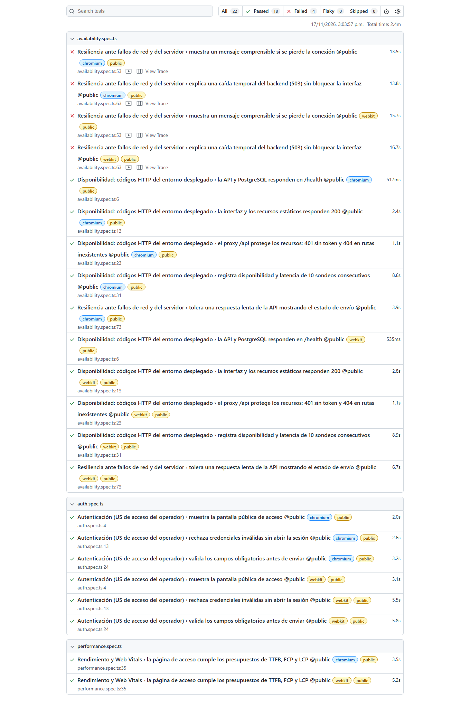
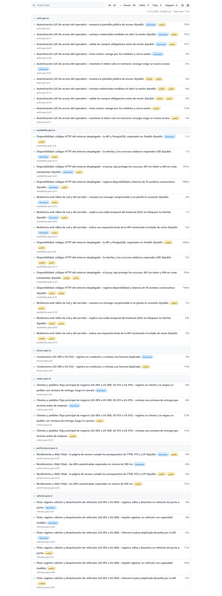

[← Volver al README principal](../../../README.md)

# Análisis de pruebas E2E y monitoreo con Playwright

| Campo | Detalle |
|---|---|
| Proyecto | EcoLogística Lima — versión de aplicación 1.5.0 |
| Líder del proyecto | Martinez Llanos, Marco Jhair |
| Herramienta | `@playwright/test` 1.64.1 (TypeScript) |
| Navegadores | Chromium, Firefox y WebKit (perfiles *Desktop Chrome*, *Desktop Firefox*, *Desktop Safari*) |
| Jira | ECO-79 (pruebas E2E) y ECO-80 (rendimiento y disponibilidad) |
| Versión del documento | V_1_0_0 · 17/11/2026 |

## 1. Resumen de resultados

| Ejecución | Objetivo | Resultado | Evidencia |
|---|---|---|---|
| GitHub Actions `tests.yml`, run [44168893833](https://github.com/jmartinez278/Ecolog-stica_Lima/actions/runs/44168893833), commit `3beb525` | Build de producción + API FastAPI + PostgreSQL 16 con migraciones Alembic | Jobs **Chromium, Firefox y WebKit en éxito** (20 de 20 casos por navegador; la configuración usa `retries: 0` y `forbidOnly`, así que un fallo o una prueba inestable habría hecho fallar el job) | Artifacts `playwright-report-{chromium,firefox,webkit}` y `playwright-results-*` (30 días) |
| Local Windows 11, 17/11/2026 | Build de producción 1.5.0 (`vite preview`) + API real sobre SQLite `test_e2e` | **40/40 aprobadas** (20 Chromium + 20 WebKit), 0 inestables | [resultados-playwright.json](evidencias/local-20261117/resultados-playwright.json), [reporte HTML](evidencias/local-20261117/reporte-html-local.png) |
| Producción v1.4.0, 17/11/2026 | [ecologistica-lima.vercel.app](https://ecologistica-lima.vercel.app) + API Render, solo pruebas `@public` | **18/22 aprobadas**: las 4 fallas revelaron el defecto de mensajes de error corregido en 1.5.0 (sección 6.3) | [resultados-playwright.json](evidencias/produccion-antes-20261117/resultados-playwright.json), [reporte HTML](evidencias/produccion-antes-20261117/reporte-html-produccion.png) |

Localmente Firefox no se pudo iniciar: Windows no tenía la biblioteca `msvcp140_1.dll` (Visual C++ Redistributable). Es una limitación de esa máquina; en Ubuntu (GitHub Actions) Firefox se ejecutó con éxito.

## 2. Configuración del entorno de pruebas

### 2.1 Arquitectura de carpetas

```text
src/frontend/
├── playwright.config.ts         # navegadores, servidores, reportes y modo producción
├── tsconfig.e2e.json            # verificación de tipos de la suite (npm run lint)
└── e2e/
    ├── auth.spec.ts             # acceso, validación, navegación, sesión en memoria
    ├── vehicles.spec.ts         # flota: alta, edición, desactivación, validaciones
    ├── orders.spec.ts           # cliente → pedido con ventana horaria → cancelación
    ├── drivers.spec.ts          # conductores y licencia duplicada
    ├── performance.spec.ts      # TTFB, FCP, LCP y tiempos de API
    ├── availability.spec.ts     # códigos HTTP, sondeos de disponibilidad, resiliencia
    └── support/
        ├── fixtures.ts          # login, navegación, paginación, registro de métricas
        ├── global-setup.ts      # limpia test-results/metrics antes de cada corrida
        ├── summarize-metrics.mjs# tabla Markdown para el resumen del job
        ├── export-results.mjs   # resumen versionable de results.json
        └── capture-report.mjs   # captura PNG del reporte HTML
scripts/e2e_backend.py           # arranca la API real sobre una base test_* aislada
```

### 2.2 `playwright.config.ts`

La suite prueba el sistema real, no simulaciones: Playwright inicia dos servidores antes de las pruebas.

1. **API FastAPI** mediante `scripts/e2e_backend.py`. El script rechaza cualquier base cuyo nombre no sea `test_*` o `*_test`; en PostgreSQL aplica `alembic upgrade head` y en SQLite crea el esquema desde los modelos. Luego ejecuta la semilla idempotente (roles, operador y cliente de ejemplo) y uvicorn en el puerto 8010.
2. **Frontend de producción** con `vite preview` en el puerto 4173, que sirve el mismo `dist/` que se despliega y reenvía `/api` a la API.

Fragmento principal:

```ts
export default defineConfig({
  testDir: './e2e',
  globalSetup: './e2e/support/global-setup.ts',
  fullyParallel: true,
  forbidOnly: !!process.env.CI,
  retries: 0,
  workers: process.env.CI ? 2 : 3,
  grep: external ? /@public/ : undefined,      // en producción solo pruebas de lectura
  reporter: [['list'], ['html', { open: 'never', outputFolder: 'playwright-report' }],
             ['json', { outputFile: 'test-results/results.json' }],
             ['junit', { outputFile: 'test-results/junit.xml' }]],
  use: { baseURL: external || 'http://127.0.0.1:4173', locale: 'es-PE', timezoneId: 'America/Lima',
         trace: 'retain-on-failure', screenshot: 'only-on-failure', video: 'retain-on-failure' },
  projects: [
    { name: 'chromium', use: { ...devices['Desktop Chrome'] } },
    { name: 'firefox', use: { ...devices['Desktop Firefox'] } },
    { name: 'webkit', use: { ...devices['Desktop Safari'] } },
  ],
  webServer: external ? undefined : [ /* API FastAPI :8010 y vite preview :4173 */ ],
})
```

Decisiones:

- **Credenciales efímeras.** La contraseña del operador de prueba se genera aleatoriamente en cada ejecución y solo existe en la base `test_*`. No hay contraseñas en el repositorio.
- **Sin reintentos.** `retries: 0` evita ocultar pruebas inestables; en local se repitió la suite dos veces seguidas (`--repeat-each=2`, 80/80 aprobadas) para descartar inestabilidad.
- **Modo producción.** Con `E2E_BASE_URL` no se levantan servidores y solo corren las pruebas etiquetadas `@public`, que no inician sesión ni escriben datos en la base de Render.

### 2.3 Integración en GitHub Actions

El job `e2e` de [`tests.yml`](../../../.github/workflows/tests.yml) usa una matriz `browser: [chromium, firefox, webkit]`, un contenedor de servicio `postgres:16-alpine` con base `ecologistica_e2e_test`, instala solo el navegador del job (`npx playwright install --with-deps`) y publica `playwright-report-<navegador>` y `playwright-results-<navegador>` como artifacts. `deploy-production.yml` repite las pruebas `@public` contra producción después de cada despliegue y `tests.yml` lo hace cada 6 horas (`production-monitor`).

## 3. Pruebas End-to-End

### 3.1 Casos de prueba

| # | Archivo | Caso | Tipo | `@public` |
|---|---|---|---|---|
| 1 | auth | Muestra la pantalla de acceso (HTTP 200, título, campos) | Autenticación | Sí |
| 2 | auth | Rechaza credenciales inválidas (401, alerta “Credenciales inválidas”, sin navegación) | Autenticación | Sí |
| 3 | auth | Valida campos obligatorios y formato de correo sin enviar petición | Validación de formulario | Sí |
| 4 | auth | Inicia sesión, recorre los cuatro módulos (`aria-current`) y cierra sesión | Flujo principal | No |
| 5 | auth | El token no se guarda en `localStorage`/`sessionStorage`; recargar exige acceso | Seguridad | No |
| 6 | vehicles | Registra, edita a MANTENIMIENTO y desactiva un vehículo; comprueba INACTIVO en la API | Flujo de negocio (US-001–004) | No |
| 7 | vehicles | Capacidad 0 bloqueada por `rangeUnderflow`, sin POST | Validación de formulario | No |
| 8 | vehicles | Placa duplicada: alerta “La placa ya está registrada” (409) | Regla de negocio | No |
| 9 | orders | Cliente nuevo → pedido ALTA con ventana horaria → PENDIENTE en API → cancelación → CANCELADO | Flujo de negocio (US-005–008, 013–015) | No |
| 10 | orders | Ventana que termina antes de empezar: 422 y alerta | Regla de negocio | No |
| 11 | drivers | Registra conductor y rechaza licencia duplicada | Flujo y regla (US-009–012) | No |
| 12 | performance | TTFB, FCP y LCP de la pantalla de acceso dentro del presupuesto | Rendimiento | Sí |
| 13 | performance | APIs autenticadas de los cuatro módulos en menos de 500 ms | Rendimiento | No |
| 14 | availability | `/health` de la API y PostgreSQL responde 200 `{status: ok}` | Disponibilidad | Sí |
| 15 | availability | Interfaz y recursos estáticos sin respuestas ≥ 400 | Disponibilidad | Sí |
| 16 | availability | Proxy `/api`: 401 con `no-store` sin token y 404 en ruta inexistente | Disponibilidad | Sí |
| 17 | availability | 10 sondeos consecutivos por destino con latencia p50/p95 | Disponibilidad | Sí |
| 18 | availability | Pérdida de conexión: mensaje comprensible y botón habilitado | Resiliencia | Sí |
| 19 | availability | Backend 503: mensaje de indisponibilidad con código | Resiliencia | Sí |
| 20 | availability | API lenta (1,5 s): botón “Ingresando…” deshabilitado y luego el resultado | Resiliencia | Sí |

### 3.2 Código fuente relevante

Flujo de negocio completo con verificación independiente en la API (`e2e/orders.spec.ts`, extracto):

```ts
await clientSelect.selectOption({ label: clientName })
await page.getByLabel('Código de pedido').fill(code)
await page.getByLabel('Inicio de ventana').fill('2026-12-01T09:00')
await page.getByLabel('Fin de ventana').fill('2026-12-01T12:00')
await page.getByLabel('Prioridad').selectOption('ALTA')
await page.getByRole('button', { name: 'Registrar' }).click()
await expect(page.getByRole('status').filter({ hasText: 'Pedido registrado.' })).toBeVisible()

const orders = await (await page.request.get('/api/v1/pedidos', { headers })).json()
expect(orders.find(order => order.codigo_pedido === code)).toMatchObject({ estado: 'PENDIENTE', prioridad: 'ALTA' })
```

Los selectores usan roles y etiquetas accesibles (`getByRole`, `getByLabel`), los mismos que usa un lector de pantalla; así, las pruebas también protegen la accesibilidad lograda en el Sprint 3. Cada registro usa un código único por navegador y ejecución para que los tres navegadores corran en paralelo sobre la misma base sin colisiones. Como los listados se ordenan por fecha de creación en páginas de 12, `goToLastPage` avanza esperando cada carga antes de buscar el registro nuevo.

### 3.3 Resultados de ejecución

| Ejecución | Chromium | Firefox | WebKit | Tasa de éxito |
|---|---|---|---|---|
| CI `tests.yml` (PostgreSQL) | 20/20 | 20/20 | 20/20 | 100 % |
| Local (SQLite), corrida final | 20/20 | No ejecutado (DLL de Windows) | 20/20 | 100 % |
| Local, `--repeat-each=2` | 40/40 | No ejecutado | 40/40 | 100 % |
| Producción v1.4.0, `@public` | 9/11 | No ejecutado | 9/11 | 81,8 % (defecto real, sección 6.3) |

## 4. Monitoreo de rendimiento

### 4.1 Método

`performance.spec.ts` lee las métricas que mide el propio navegador:

- **TTFB:** `responseStart − startTime` de *Navigation Timing*.
- **FCP:** entrada `first-contentful-paint` de *Paint Timing*.
- **LCP:** `PerformanceObserver` de `largest-contentful-paint` con `buffered: true`. WebKit no expone esta API en todas las versiones; si no está disponible se registra como “no soportado” en lugar de inventar un valor.
- **Tiempo de API:** `responseEnd − startTime` de *Resource Timing* para la petición real de cada módulo.

Presupuestos: TTFB < 800 ms, FCP < 1.800 ms, LCP < 2.500 ms (umbral “bueno” de Core Web Vitals) y API < 500 ms.

### 4.2 Resultados

**Pantalla de acceso (Web Vitals):**

| Entorno | Navegador | TTFB | FCP | LCP | `load` | Bytes del documento |
|---|---|---|---|---|---|---|
| Local, build 1.5.0 | Chromium | 8 ms | 184 ms | 184 ms | 168 ms | 1.788 |
| Local, build 1.5.0 | WebKit | 78 ms | 369 ms | 369 ms | 585 ms | 1.788 |
| Producción Vercel (1.4.0) | Chromium | 305 ms | 860 ms | 860 ms | 863 ms | 1.817 |
| Producción Vercel (1.4.0) | WebKit | 410 ms | 895 ms | 895 ms | 946 ms | 1.817 |

Todas las mediciones cumplen los presupuestos. En producción el TTFB incluye la red desde Lima hasta el CDN de Vercel.

**Tiempos de respuesta de API (local, build 1.5.0, primera carga de cada módulo):**

| Endpoint | Chromium | WebKit | Presupuesto |
|---|---|---|---|
| `GET /api/v1/vehiculos?page=1&limit=12` | 37 ms | 21 ms | < 500 ms ✔ |
| `GET /api/v1/pedidos?page=1&limit=12` | 43 ms | 51 ms | < 500 ms ✔ |
| `GET /api/v1/conductores?page=1&limit=12` | 103 ms | 18 ms | < 500 ms ✔ |
| `GET /api/v1/clientes?page=1&limit=12` | 72 ms | 17 ms | < 500 ms ✔ |
| `POST /api/v1/auth/login` (informativo) | 196 ms | 328 ms | Sin presupuesto: incluye el hash de contraseña |

El inicio de sesión no tiene presupuesto de 500 ms porque su costo principal es la verificación del hash de la contraseña, que es lenta a propósito para resistir ataques de fuerza bruta. En una corrida previa con tres workers en paralelo llegó a 1.414 ms; por eso no se le aplica el umbral de los listados.

## 5. Disponibilidad y resiliencia

### 5.1 Códigos de estado HTTP verificados

| Petición | Esperado | Local | Producción |
|---|---|---|---|
| `GET /` (interfaz) | 200, `text/html` | 200 | 200 |
| Recursos estáticos del acceso | Ninguno ≥ 400 | Correcto | Correcto |
| `GET /health` (API + `SELECT 1` en PostgreSQL) | 200 `{"status":"ok"}` | 200 | 200 |
| `GET /api/v1/vehiculos` sin token | 401 con `Cache-Control: no-store` | 401 | 401 |
| `GET /api/v1/ruta-inexistente` | 404 | 404 | 404 |
| `POST /api/v1/auth/login` con credenciales inválidas | 401 | 401 | 401 |

### 5.2 Sondeos de disponibilidad (10 peticiones consecutivas por destino)

| Entorno · navegador | Destino | Disponibilidad | p50 | p95 |
|---|---|---|---|---|
| Producción · Chromium | Interfaz (Vercel) | 10/10 (100 %) | 110 ms | 316 ms |
| Producción · Chromium | API vía proxy Vercel → Render | 10/10 (100 %) | 364 ms | 831 ms |
| Producción · Chromium | `/health` directo en Render | 10/10 (100 %) | 216 ms | 547 ms |
| Producción · WebKit | Interfaz (Vercel) | 10/10 (100 %) | 119 ms | 464 ms |
| Producción · WebKit | API vía proxy | 10/10 (100 %) | 412 ms | 821 ms |
| Producción · WebKit | `/health` directo | 10/10 (100 %) | 299 ms | 321 ms |
| Local · Chromium | Interfaz / proxy / health | 100 % en los tres | 9 / 12 / 10 ms | 17 / 14 / 11 ms |

La mediana de la API en producción está por debajo de 500 ms, pero el p95 a través del proxy (821–831 ms) lo supera. Se explica por el salto Vercel → Render en Oregon y por el plan gratuito; se registra como deuda técnica en la [revisión del Sprint](<01 Revisión del Sprint V_1_0_0.md>).

### 5.3 Arranque en frío y *uptime*

Render suspende el servicio gratuito tras un periodo sin tráfico. El sondeo previo a la suite (17/11/2026, 20:00 UTC) registró ([evidencia](evidencias/produccion-antes-20261117/sondeo-arranque-frio.txt)):

| URL | Código | Tiempo total |
|---|---|---|
| `https://ecologistica-lima.vercel.app/` | 200 | 1,17 s |
| `https://ecologistica-lima-api-ktea.onrender.com/health` | 200 | **37,61 s** (arranque en frío) |
| `https://ecologistica-lima.vercel.app/api/v1/vehiculos` | 401 | 0,94 s |

Ya despierta, la API respondió el 100 % de los sondeos. Para medir el *uptime* de forma continua, `production-monitor` en `tests.yml` corre cada 6 horas: despierta la API con hasta 3 reintentos, registra el tiempo de arranque en el resumen del job y ejecuta las pruebas `@public`. El historial de esas ejecuciones en GitHub Actions es el registro de disponibilidad del entorno desplegado. El objetivo de 99,5 % en horario operativo del README requiere un plan sin suspensión por inactividad.

### 5.4 Manejo de errores de red

`availability.spec.ts` intercepta la petición de acceso con `page.route()` para simular tres fallos:

```ts
await page.route('**/api/v1/auth/login', route => route.abort('internetdisconnected'))
// ...
await expect(page.getByRole('alert'))
  .toHaveText('No se pudo conectar con el servidor. Revisa tu conexión e inténtalo nuevamente.')
```

## 6. Hallazgos y mejoras aplicadas

### 6.1 Arranque en frío de Render

37,6 s para la primera petición. Mitigación aplicada: el monitoreo y la verificación post-despliegue despiertan la API antes de medir. Mitigación pendiente: plan con instancia siempre activa.

### 6.2 Latencia p95 del proxy en producción

821–831 ms en el p95 de la API a través de Vercel. Queda como deuda técnica junto con la región del backend.

### 6.3 Mensajes de error dependientes del navegador (corregido en 1.5.0)

En producción (1.4.0) las pruebas 18 y 19 fallaron en Chromium y WebKit:

| Situación | Mensaje en 1.4.0 | Mensaje en 1.5.0 |
|---|---|---|
| Sin conexión (Chromium) | `Failed to fetch` | No se pudo conectar con el servidor. Revisa tu conexión e inténtalo nuevamente. |
| Sin conexión (WebKit) | `Load failed` | El mismo mensaje |
| Backend 503 | `Error 503` | El servicio no está disponible en este momento. Inténtalo nuevamente en unos segundos. (Error 503) |

La corrección está en `src/frontend/src/api.ts`: `fetch` se envuelve en `try/catch`, las cancelaciones intencionales (`AbortError`) se propagan sin cambios y los códigos 502/503/504 sin detalle JSON reciben un mensaje claro. Se añadieron ocho casos de prueba unitarios en `api.test.tsx`. Con la versión 1.5.0, las 20 pruebas pasan en los tres navegadores en CI. Al desplegar en producción, el job `verify` de `deploy-production.yml` confirmará la corrección sobre la URL pública.





## 7. Cómo reproducir

```bash
cd src/frontend
npm ci && npx playwright install
npm run build
E2E_SKIP_BUILD=1 E2E_PYTHON=python npx playwright test          # suite completa
npx playwright show-report                                      # reporte HTML
E2E_BASE_URL=https://ecologistica-lima.vercel.app \
E2E_API_URL=https://ecologistica-lima-api-ktea.onrender.com npm run e2e:prod   # solo lectura
npm run e2e:metrics                                             # tabla de métricas
```

[← Volver al README principal](../../../README.md)
